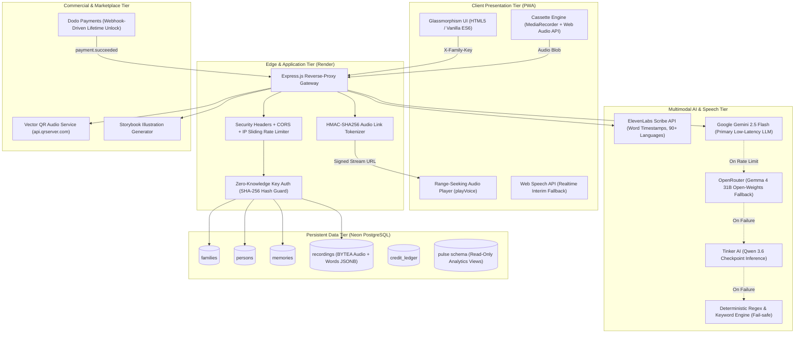
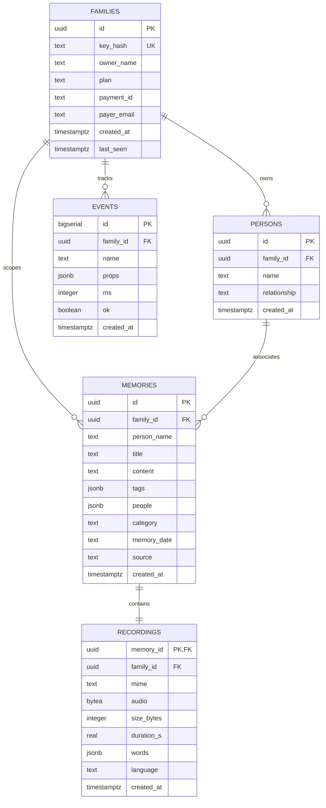

# Memoria — System Design & Technical Architecture

```
 ┌────────────────────────────────────────────────────────────────────────┐
 │                              MEMORIA.TECH                              │
 │                 The Generational Wisdom & Oral History Vault           │
 └────────────────────────────────────────────────────────────────────────┘
```

---

## 1. High-Level Design (HLD)

Memoria is architected as an **offline-resilient, privacy-first, multi-tenant oral-history engine**. It captures spoken memories from family members, transcribes them with word-level timestamps, extracts structured knowledge and timeline metadata without hallucination, and enables ground-truthed conversational retrieval.



---

## 2. Low-Level Design (LLD): Database Schemas

All data is strictly multi-tenant, partitioned by `family_id (UUID)`. No tenant can ever access another family's oral records.



---

## 3. Core Algorithms & Subsystem Engineering

### 3.1 Cryptographic Signed Audio Streaming (`src/recordings.js`)
Standard `<audio>` tags cannot pass custom authorization headers (such as `X-Family-Key`). To prevent unauthorized access and link harvesting while maintaining compatibility with browser streaming:
1. The server signs URLs using HMAC-SHA256 with a 6-hour TTL:
   $$\text{Signature} = \text{HMAC-SHA256}(\text{SIGNING\_KEY}, \text{memoryId} \mathbin{\Vert} \text{exp})$$
2. Verification enforces timing-safe comparisons (`crypto.timingSafeEqual`) to prevent side-channel timing attacks.
3. The audio endpoint (`/api/audio/:id`) implements **HTTP 206 Partial Content** range requests (`Accept-Ranges: bytes`), allowing low-latency seeking and scrubbing without buffering the entire binary blob.

### 3.2 Sliding-Window Word Alignment (`clipFor`)
When a user asks a question in the **Ask** interface:
1. Gemini retrieves the most relevant memory and synthesizes a warm, grounded summary.
2. `clipFor(words, quote)` normalizes the words from the quote and scans the timestamped words recorded by ElevenLabs Scribe:
   - Evaluates a sliding window $W$ of length $L = \min(\text{len}(\text{target}), \text{len}(\text{spoken}))$.
   - Trims unmatched tokens from the boundaries.
   - Computes `{ start, end }` in seconds with an intentional $0.25\text{s}$ pre-roll buffer.
3. The UI allows the user to click **"Hear them say it"**, which seeks the HTML5 audio element directly to the computed offset and halts playback upon reaching `end`.

### 3.3 Zero-Hallucination Date Grounding (`settleDate`)
LLMs often hallucinate exact years (e.g., claiming a story happened in "1955" when the speaker never mentioned a date). 
- `settleDate(transcript, proposedDate)` verifies whether the 4-digit year extracted by the model was actually spoken in the raw text.
- If the speaker expressed uncertainty (*"I think it was 1978 or maybe 79"*), the regex hedge-detector preserves the exact human wording: `"1978 or 1979"`.
- If no year was uttered, hallucinated years are strictly pruned to `null`.

---

## 4. Multi-Tier AI Resilience Pipeline

Memoria guarantees **zero downtime** for AI processing through an automated 4-tier fallback state machine:

```
Tier 1: Google Gemini 2.5 Flash (Google AI Studio)
   │  Latency: ~400ms | Free Tier | Multimodal reasoning
   ▼ (if quota exceeded, rate-limited, or network error)
Tier 2: OpenRouter (Google Gemma 4 31B Open-Weights)
   │  Latency: ~1.2s | High parameter open-source core
   ▼ (if unreachable or credit guard triggered)
Tier 3: Tinker AI (Qwen 3.6 Checkpoint)
   │  Latency: ~2.5s | Standalone inference endpoint
   ▼ (if offline)
Tier 4: Built-in Deterministic Heuristics Engine
   │  Latency: < 2ms | Local Regex, Frequency Scoring, Exact Quoting
   ▼
Guaranteed 200 OK Response (Zero 500 error screens)
```

---

## 5. REST API Specification

| Endpoint | Method | Auth | Description |
|---|---|---|---|
| `/api/health` | `GET` | Public | System status, active AI engine, payment gateway status |
| `/api/family` | `POST` | Public | Creates a new isolated family space; returns secret key |
| `/api/family` | `GET` | `X-Family-Key` | Returns family metadata, limits, and plan status |
| `/api/persons` | `GET` | `X-Family-Key` | Lists all loved ones in the family space |
| `/api/persons` | `POST` | `X-Family-Key` | Adds a new person (Grandma, Dad, Partner, Self) |
| `/api/record` | `POST` | `X-Family-Key` | Uploads multipart audio memo; transcribes, tags & saves |
| `/api/memories` | `GET` | `X-Family-Key` | Fetches filtered memories for a specific person |
| `/api/memories/:id`| `PATCH` | `X-Family-Key` | Updates title, content, or timeline date |
| `/api/chat` | `POST` | `X-Family-Key` | Grounded Q&A against personal knowledge modules |
| `/api/memories/:id/voice` | `GET` | `X-Family-Key` | Generates signed streaming URL for real audio |
| `/api/audio/:id` | `GET` | Signed Query | Byte-range binary audio streaming |
| `/api/export/:person` | `GET` | `X-Family-Key` | Exports complete unencrypted JSON family archive |
| `/api/billing/checkout` | `POST` | `X-Family-Key` | Initiates Dodo Payments $19 Lifetime checkout |
| `/api/billing/webhook` | `POST` | HMAC Header | Webhook receiver for automatic plan unlocking |
